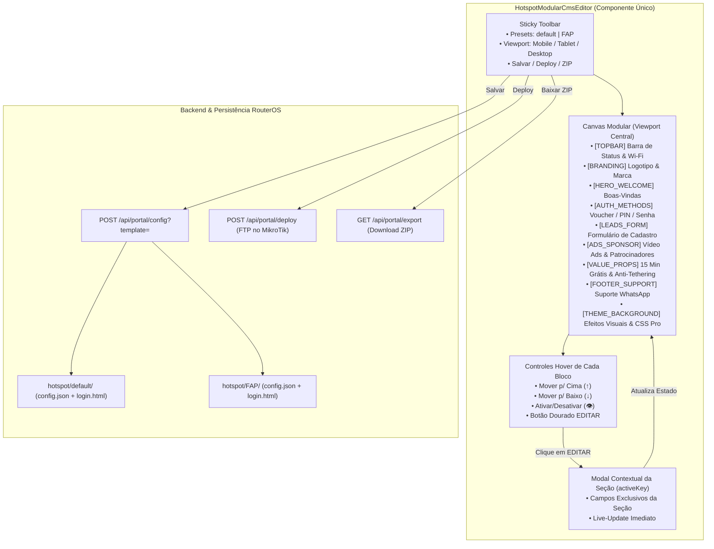

# Arquitetura do Novo Editor de Hotspot Visual CMS (WYSIWYG Modular Único)

> **Documento Oficial de Engenharia & Arquitetura**  
> **Referência Direta:** Baseado fielmente no formato e UX do componente único `VisualCmsEditor.jsx` do projeto `bizu-artigomilitar`.  
> **Status:** Concluído • Zero Misturas • 100% Compatível com RouterOS v6/v7.

---

## 1. Visão Geral e Princípio de Design

O editor anterior possuía barras laterais concorrentes, abas dispersas e sobreposição de controles.  
O novo **Editor Visual Hotspot (`HotspotModularCmsEditor`)** foi construído como **um único componente unificado**, trazendo a mesma fluidez e simplicidade do `VisualCmsEditor` do e-commerce militar:

1. **Toolbar Sticky Superior Única:**
   * Título oficial com badge animado: `EDITOR VISUAL HOTSPOT (WYSIWYG)`.
   * **Seletor 1-Clique dos 2 Presets Oficiais:**
     * `⚡ Padrão Cyber (default)`: Tema Dark com cantos pill, fibra ótica e login direto por voucher.
     * `🎓 FAP Campus (FAP)`: Tema oficial da Faculdade Adventista do Paraná, com contraste institucional, card branco e captação de leads.
   * Alternância de Telas: `Login` e `Cadastro`.
   * Seleção de Viewport: Mobile (`390px`), Tablet (`768px`) e Desktop (`100%`).
   * Ações Integradas: `Baixar ZIP`, `Deploy MikroTik` e `Salvar Alterações`.

2. **Canvas Central Modular com Drag & Drop (Reordenação):**
   * Cada bloco do Captive Portal funciona como uma seção modular independente.
   * Ao passar o mouse sobre qualquer seção:
     * Uma borda dourada/âmbar (`group-hover:border-amber-500/70`) destaca o elemento.
     * Uma barra flutuante de controle é exibida no canto superior direito:
       * **Setas de Reordenação (Cima / Baixo):** Altera a ordem dos blocos na tela (Drag & Drop modular).
       * **Olho (Ativar / Desativar):** Oculta ou exibe a seção no portal.
       * **Badge da Seção:** Identifica claramente o componente (ex: `IDENTIDADE & LOGOTIPO`).
       * **Botão Dourado EDITAR:** Abre o modal de edição focado.

3. **Modal de Edição Contextual Único (`activeKey`):**
   * Ao clicar em **`EDITAR`**, abre-se o modal escuro (`bg-[#111827]`), idêntico ao do `VisualCmsEditor`:
     * Cabeçalho com ícone, título da seção e botão `X`.
     * Campos dedicados e objetivos (upload de logotipo, textos, botões, regras de Wi-Fi, mídias e CSS).
     * Botão inferior `Concluir Edição` que sincroniza imediatamente com a visualização.

---

## 2. Diagrama de Fluxo do Editor Único

---

## 3. Presets Nativos e Arquivos Físicos

Os dois modelos obrigatórios estão preservados em:
1. **[`hotspot/default/`](hotspot/default)**: Configuração e template do preset `⚡ Padrão Cyber Dark`.
2. **[`hotspot/FAP/`](hotspot/FAP)**: Configuração e template do preset `🎓 FAP Campus`.

O salvamento e deploy gravam diretamente na pasta do preset ativo, assegurando retrocompatibilidade absoluta com as regras do `AGENTS.md` e a sintaxe do MikroTik RouterOS v6 e v7.
