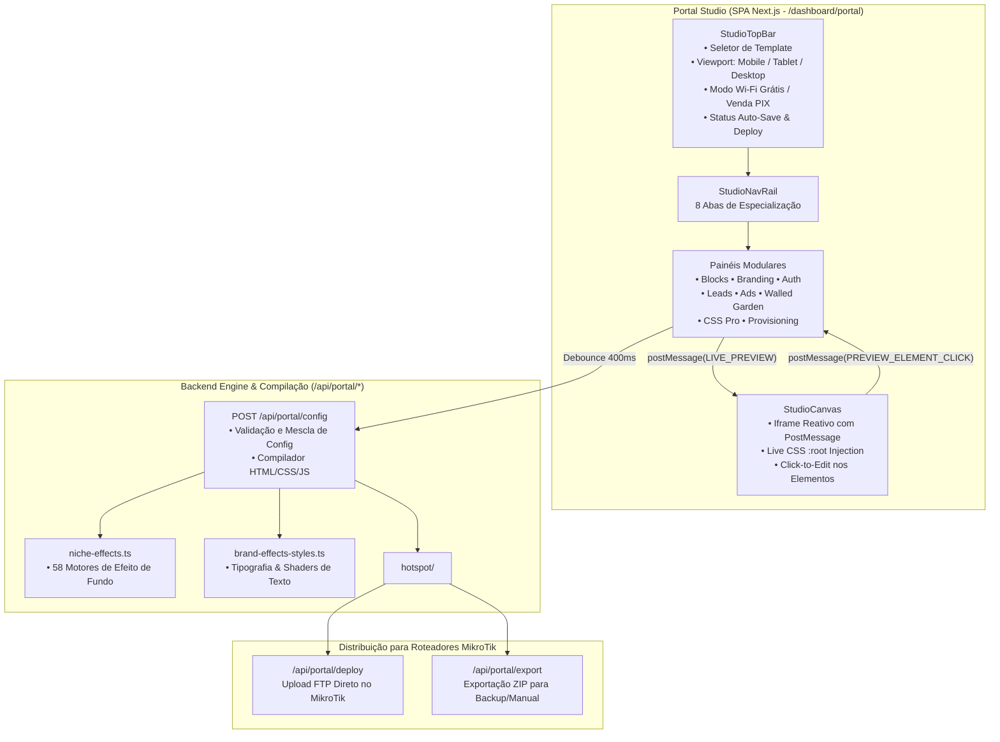

# Arquitetura do Portal Studio & Hotspot Visual CMS

> **Documento Oficial de Engenharia & Arquitetura de Software**  
> **Módulo:** Portal Studio (`/dashboard/portal`)  
> **Status:** Atualizado • 100% Compatível com MikroTik RouterOS v6 e v7 • Live WYSIWYG

---

## 1. Visão Geral e Princípio de Design

O **Portal Studio** é o ambiente integrado de autoria, personalização e compilação de portais de autenticação (Captive Portals) do MikroGestor. Ele foi desenhado para unir a facilidade de um editor visual no-code/low-code com a precisão exigida pela engine de captive portal do MikroTik RouterOS.

Diferente de editores web convencionais, o Portal Studio atua como um **transpilador em tempo real**:
1. O operador ajusta temas, blocos, cores, textos, anúncios e formulários de leads visualmente.
2. O editor mantém um canvas com *Live Preview* bidirecional alimentado por eventos `postMessage`.
3. Um mecanismo de auto-save com debounce de 400ms grava a configuração estruturada no `config.json` do template ativo e recompila os artefatos HTML prontos para upload via FTP no MikroTik.



---

## 2. Componentes da Interface (Frontend)

A interface em `src/app/dashboard/portal/page.tsx` está estruturada em três eixos principais:

### 2.1. Top Bar de Ações Globais (`StudioTopBar.tsx`)
- **Seletor Dinâmico de Template:** Carrega em tempo real as pastas disponíveis em `hotspot/` via `GET /api/portal/templates` (`default`, `FAP`, `OLIMPORI`, `Bubblegum Hardcore`, etc.).
- **Seletor de Viewport:** Permite alternar o iframe entre `Mobile (390px)`, `Tablet (768px)` e `Desktop (100%)`.
- **Alternância de Modo Operacional Mestre:**
  - *Modo 100% Gratuito*: Focado em vouchers cortesia, captação de leads e termos de aceite.
  - *Modo Venda de Acesso via PIX*: Ativa a vitrine de planos, geração dinâmica de QR Code Copia e Cola e desbloqueio automatizado pós-webhook bancário.
- **Auto-Save Status Indicator:** Exibe status visual em tempo real (`Salvando...`, `Salvo às HH:mm`, `Erro`).
- **Ações Rápidas:** Botões de `Deploy MikroTik` (abre modal FTP) e `Baixar ZIP`.

### 2.2. Barra de Navegação Rápida (`StudioNavRail.tsx`)
Menu vertical com 8 abas de domínio exclusivo:

| Aba | Identificador | Painel Responsável | Finalidade |
| :--- | :--- | :--- | :--- |
| **Blocos** | `blocks` | `BlocksStudioPanel.tsx` | Ativação, desativação e reordenação dos componentes da tela. |
| **Identidade** | `branding` | `BrandingStudioPanel.tsx` | Logotipo, cores (60+ presets), fontes, glassmorphism e efeitos de nicho. |
| **Autenticação** | `auth_methods` | `HotspotAuthStudioPanel.tsx` | Formulário de voucher, botão de teste (trial 15/30 min) e login social. |
| **Leads** | `leads_form` | `LeadsFieldsStudioPanel.tsx` | Configuração de campos do formulário (nome, CPF, telefone, data de nascimento). |
| **Anúncios** | `ads` | `AdsStudioPanel.tsx` | Campanhas de vídeo e banners patrocinados com skip timer obrigatório. |
| **Walled Garden** | `walled_garden` | `WalledGardenStudioPanel.tsx` | Liberações pré-login e botão flutuante de suporte via WhatsApp. |
| **CSS Pro** | `css_pro` | `CssProStudioPanel.tsx` | Editor de código com realce de sintaxe para overrides de estilo CSS. |
| **Provisionamento**| `provisioning` | `ProvisioningStudioPanel.tsx` | Auditoria de interfaces, criação de bridge e regras de firewall no MikroTik. |

### 2.3. Canvas com Live Preview Bidirecional (`StudioCanvas.tsx`)
- Executa o portal em um iframe isolado carregando `/api/portal/preview?template=<nome>`.
- **Sincronização em Tempo Real (`postMessage`):**
  - Ao alterar qualquer slider ou cor na UI, o Studio despacha uma mensagem `LIVE_PREVIEW` para o iframe, que atualiza suas variáveis CSS sem recarregar o DOM.
  - Ao clicar diretamente em um elemento no preview (ex: botão de voucher ou logo), o iframe envia `PREVIEW_ELEMENT_CLICK`, fazendo o editor abrir automaticamente a aba relevante.

---

## 3. Pipeline de Compilação & Backend

A API central em `src/app/api/portal/config/route.ts` orquestra a geração dos arquivos físicos:

### 3.1. Variáveis CSS Injetadas Dinamicamente
O compilador injeta na tag `<style id="dynamic-theme-vars">` do HTML as variáveis calculadas:

```css
:root {
  --primary: #0284c7;
  --primary-dark: #0369a1;
  --bg-dark: #090a0f;
  --ink: #f8fafc;
  --muted: #94a3b8;
  --card-bg: #12131f;
  --card-border: #0284c7;
  --card-radius-tl: 20px;
  --card-radius-tr: 20px;
  --card-radius-br: 20px;
  --card-radius-bl: 20px;
  --card-padding: 24px;
  --glass-opacity: 0.85;
  --glass-blur: 16px;
  --btn-radius-tl: 12px;
  --btn-radius-tr: 12px;
  --btn-radius-br: 12px;
  --btn-radius-bl: 12px;
  --font-family: 'Inter', sans-serif;
}
```

### 3.2. Motores de Efeitos de Nicho (`src/lib/niche-effects.ts`)
Disponibiliza motores visuais embutidos via canvas ou CSS:
- **Efeitos Universais:** `aurora`, `particles`, `cyber-grid`, `floating-orbs`, `matrix`, `wave-mesh`, `fiber-optic`.
- **Efeitos Temáticos por Nicho:**
  - *Fitness & Saúde:* `cardio-pulse`, `medical-vital`, `gym-iron`.
  - *Gastronomia:* `burgers-fall`, `pizza-float`, `coffee-steam`, `beer-foam`.
  - *Educação & Corporativo:* `fap-adventista`, `clean-corporate`.
  - *Pop & Neo-Brutalism:* `bubblegum-pop`.
  - *Aventura & Natureza:* `custom-olimpori-3d`, `fireflies`.

---

## 4. Estrutura dos Arquivos Físicos (`hotspot/`)

Cada template cadastrado reside em sua própria pasta dentro de `hotspot/`:

```text
hotspot/
├── default/               # Template Padrão Cyber Dark
├── FAP/                   # Template Oficial FAP Campus
├── OLIMPORI/              # Template Especial 3D Natureza & Animais
├── Bubblegum Hardcore/    # Template Neo-Brutalism Pop
└── novos modelos/         # Banco de modelos experimentais
```

### Arquivos Obrigatórios em Cada Template:
1. `config.json` — Estado completo dos parâmetros de design e blocos.
2. `login.html` — Tela principal interceptada pelo MikroTik.
3. `alogin.html` — Tela de redirecionamento imediato pós-autenticação.
4. `status.html` — Tela de exibição de tempo restante, consumo de dados e botão de logout.
5. `logout.html` — Tela de encerramento de sessão.
6. `error.html` — Tela de exibição de falha de login com mensagens customizadas.
7. `md5.js` — Biblioteca oficial do MikroTik para hash CHAP de senha.
8. `redirect.html` e `radvert.html` — Telas de suporte a publicidade e redirecionamentos.

---

## 5. Diretrizes de Deploy no MikroTik (RouterOS v6 & v7)

Ao acionar **Deploy MikroTik** no Studio:
1. O backend se conecta via FTP na porta 21 do roteador (utilizando as credenciais salvas do MikroTik ou informadas no modal).
2. Cria ou sobrescreve a pasta de destino dentro do armazenamento do roteador (ex: `/flash/hotspot` ou `/hotspot`).
3. Envia todos os arquivos compilados garantindo:
   - Quebras de linha consistentes no padrão Unix/LF para evitar erros no parser do RouterOS.
   - Preservação intacta de todas as diretivas do RouterOS: `$(link-login-only)`, `$(username)`, `$(password)`, `$(error)`.
4. Atualiza o parâmetro `html-directory` no perfil do Hotspot (`/ip/hotspot/profile`) via API WireGuard (`TCP 8728/8729`) para ativar o novo template imediatamente.
